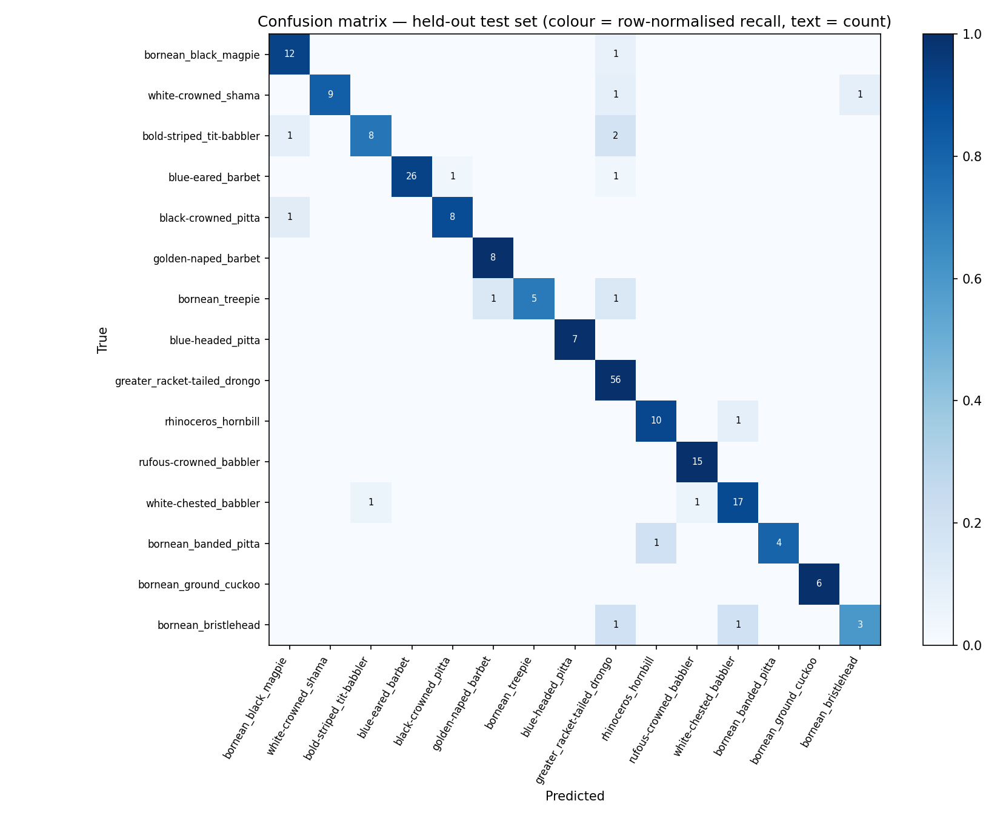
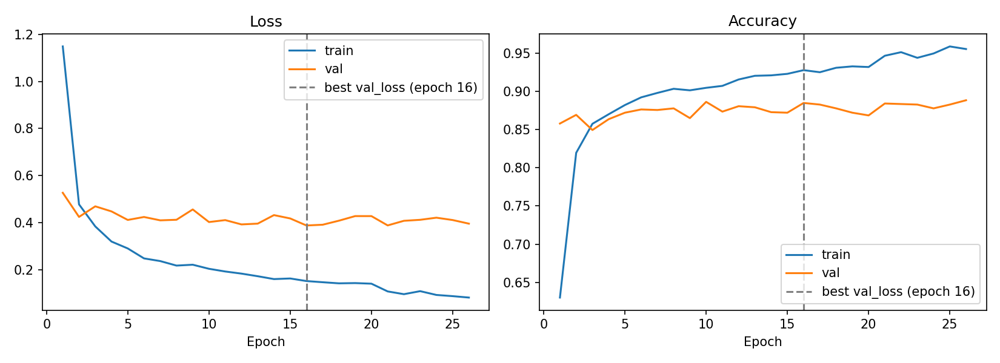

# BirdSense

BirdSense is an AI-assisted, privacy-aware web application for identifying a
selected set of Bornean bird species from audio recordings. It combines
BirdNET audio embeddings with a lightweight TensorFlow Lite classifier and a
human-in-the-loop review workflow.

> **Prototype notice:** BirdSense provides candidate identifications, not
> confirmed sightings. Users should review the confidence, alternatives, audio
> evidence, habitat context, and—when needed—consult a qualified expert.

## Features

- Audio upload and identification for 15 selected Bornean species.
- Top candidate comparison, confidence, mel-spectrogram, and approximate
  per-window detection timeline.
- Human confirmation, correction, and uncertainty feedback.
- Privacy-aware field notes that accept only a broad Sarawak region—never
  exact coordinates.
- A Sarawak field guide with broad habitat context for sensitive species.

## Model performance

BirdSense uses a **frozen BirdNET** model as a feature extractor (one
1024-dimensional embedding per ~3 s window) and trains only a small Dense head
(Dropout → Dense 256 → Dropout → softmax) on top. All figures below are
measured on a **held-out test set of 211 recordings** (15 species) that were
split off by recording *before* preprocessing and never used for training or
model selection.

> **Which model do these numbers describe?** They describe the retrained
> checkpoint in `models/checkpoints/` (not committed). The bundled
> `models/export/model.tflite` that the app serves is from an earlier training
> run (macro-F1 0.905, accuracy 0.923 on a 207-file evaluation). Run
> `python scripts/export.py` to ship the retrained model.

### Headline results

| Metric | Value |
|---|---|
| Macro-F1, majority vote over windows (export gate ≥ 0.80) | **0.899** — pass |
| Accuracy, majority vote | 0.919 |
| Top-1 accuracy, soft vote (mean softmax; what the app uses) | 0.943 |
| Top-3 accuracy, soft vote | **0.991** |
| Macro-F1, soft vote | 0.938 |

Training data: 8,475 five-second clips cut from 1,131 recordings. Validation
used 1,413 clips from 189 recordings that never appear in training.

### Per-species results (majority vote)

| Species | Precision | Recall | F1 | Test files |
|---|---:|---:|---:|---:|
| Bornean black magpie | 0.857 | 0.923 | 0.889 | 13 |
| White-crowned shama | 1.000 | 0.818 | 0.900 | 11 |
| Bold-striped tit-babbler | 0.889 | 0.727 | 0.800 | 11 |
| Blue-eared barbet | 1.000 | 0.929 | 0.963 | 28 |
| Black-crowned pitta | 0.889 | 0.889 | 0.889 | 9 |
| Golden-naped barbet | 0.889 | 1.000 | 0.941 | 8 |
| Bornean treepie | 1.000 | 0.714 | 0.833 | 7 |
| Blue-headed pitta | 1.000 | 1.000 | 1.000 | 7 |
| Greater racket-tailed drongo | 0.889 | 1.000 | 0.941 | 56 |
| Rhinoceros hornbill | 0.909 | 0.909 | 0.909 | 11 |
| Rufous-crowned babbler | 0.938 | 1.000 | 0.968 | 15 |
| White-chested babbler | 0.895 | 0.895 | 0.895 | 19 |
| Bornean banded pitta | 1.000 | 0.800 | 0.889 | 5 |
| Bornean ground cuckoo | 1.000 | 1.000 | 1.000 | 6 |
| Bornean bristlehead | 0.750 | 0.600 | 0.667 | 5 |
| **Macro average** | 0.927 | 0.880 | **0.899** | 211 |

The weakest species (bristlehead, tit-babbler, treepie) have only 5–11 test
files each, so a single misclassified recording moves their scores a lot.



### Noise robustness (simulated SNR)

White Gaussian noise added to the test audio at a fixed SNR, majority vote:

| Condition | Accuracy | Macro-F1 | Target |
|---|---:|---:|---|
| Clean | 0.919 | 0.899 | — |
| 20 dB (quiet) | 0.934 | 0.931 | ≥ 0.80 — met |
| 10 dB (moderate) | 0.886 | 0.860 | ≥ 0.65 — met |
| 5 dB (loud) | 0.825 | 0.795 | report only |

This is synthetic broadband noise, not forest ambience, so it shows tolerance
to broadband noise rather than real field robustness. With 211 files, the
20 dB score exceeding the clean score is sampling noise.

### Experiments

All experiments use the same held-out test set and are reproduced by
`python scripts/experiments.py`.

**1. Validation-split leakage.** Each recording is cut into ~7.5 clips. A
random clip-level split puts clips of the same recording on both sides of the
train/validation split; grouping by recording does not. Mean ± std over 3
seeds:

| Validation split | Recordings in both train and val | Val accuracy | Val macro-F1 | Test macro-F1 (soft) |
|---|---:|---:|---:|---:|
| Random clips | 676 of 1,131 | 0.967 ± 0.004 | 0.965 ± 0.004 | 0.935 ± 0.012 |
| Grouped by recording | 0 | 0.886 ± 0.002 | 0.872 ± 0.008 | 0.918 ± 0.014 |

The leak inflated validation accuracy by about 8 points. It did not affect the
test set (split by recording beforehand), and grouping did not measurably
change test performance: the difference is about 1.3 standard deviations. The
training pipeline now splits by recording; with that split, early stopping
triggers at epoch 26 (best validation loss at epoch 16), whereas the leaky
split ran all 60 epochs.

**2. Baselines** (grouped split, test = held-out set, soft vote):

| Model | Test top-1 | Test top-3 | Test macro-F1 |
|---|---:|---:|---:|
| Majority class | 0.265 | 0.318 | 0.028 |
| Logistic regression on the embeddings | 0.929 | 0.986 | 0.914 |
| Dense head (mean of 3 seeds) | 0.932 | 0.987 | 0.918 |

A logistic regression on the frozen embeddings is within seed noise of the
Dense head. The pretrained BirdNET embedding carries nearly all of the
performance; the head adds very little.

**3. TFLite quantisation** of the classifier head (one CPU thread on a
desktop; the head only, not BirdNET):

| Variant | Size | Test macro-F1 | Windows agreeing with float32 | Median latency |
|---|---:|---:|---:|---:|
| float32 | 1,042 KB | 0.938 | 100% | 0.019 ms |
| float16 | 522 KB | 0.938 | 100% | 0.019 ms |
| int8 (dynamic range) | 266 KB | 0.938 | 99.9% | 0.006 ms |
| int8 (full integer) | 269 KB | 0.938 | 98.9% | 0.006 ms |

Quantisation costs no file-level accuracy. It barely matters for latency
either: BirdNET embedding takes about 45 ms per window on the same CPU, versus
0.02 ms for the head. These timings are not Raspberry Pi or Jetson
measurements.



### Limitations of these results

- The test set is small (211 files; some species have 5–7). Differences of a
  point or two are within noise. The 0.938 row above is one checkpoint; the
  seed means (0.918) are the safer figure to quote.
- The augmentation described in the data rules (pitch shift, time stretch,
  background noise) is not applied in the current pipeline, so its effect has
  not been measured.
- No from-scratch CNN baseline was run, and there are no on-device latency
  measurements yet.
- Different recordings can still share a recordist, location or recording
  session; that residual leakage has not been checked.

## Run locally

Prerequisites: Python and Node.js/npm.

Start the Flask API from the repository root:

```bash
python -m pip install -r backend/requirements.txt
python backend/app.py
```

In another terminal, start the React/Vite interface:

```bash
cd frontend
npm ci
npm run dev
```

Open the local Vite URL printed in the terminal. The development server proxies
API calls to the Flask backend at `http://127.0.0.1:5000`.

## Training data and Xeno-canto licensing

The training pipeline can retrieve Grade A/B bird recordings from
[Xeno-canto](https://xeno-canto.org) using `scripts/downloader.py`. Xeno-canto
recordings are owned by their individual recordists and are licensed on a
**per-recording** basis; the applicable Creative Commons licence is shown on
each recording's Xeno-canto page. Do not assume that all Xeno-canto recordings
have the same reuse permissions.

When using any Xeno-canto recording, including for dataset creation, demos,
redistribution, or a production system:

1. Check the recording page and comply with that recording's current licence.
2. Preserve the required attribution, including the recordist, Xeno-canto
   recording ID/URL, licence, and any required indication of changes.
3. Do not use recordings with commercial, derivative-work, or share-alike
   restrictions outside the permissions of their specific licence.
4. Maintain a dataset manifest with the recording ID, recordist, source URL,
   licence, download date, and processing history.
5. Obtain permission or exclude a recording whenever its licence or provenance
   cannot be verified.

The repository does not include the full training dataset. Its small demo set
is in [`sample_audio/`](sample_audio/), with available source references in
[`sample_audio/CREDITS.md`](sample_audio/CREDITS.md). Some legacy sample clips
are explicitly marked as having unverified provenance; they must be removed or
replaced before any public, commercial, or redistributed release.

This repository does not grant rights to third-party recordings or resolve the
licensing status of model outputs. Before deployment, especially a commercial
deployment, obtain an appropriate legal and data-governance review for the
complete dataset and its intended use.

## Responsible use

- The app deliberately stores only broad regions, not exact wildlife
  coordinates, to reduce risk to sensitive species.
- Uploaded recordings and optional feedback are stored locally by the current
  prototype. A production system should add retention controls, deletion,
  authentication, and secure storage.
- Conservation labels are contextual information and should be refreshed from
  authoritative sources before use in field or management decisions.
- The current model is limited to 15 species and can be affected by noise,
  overlapping calls, unseen species, recording equipment, and uneven training
  data. Low-confidence results must not be treated as identifications.

## Project structure

- `frontend/` — React/Vite user interface.
- `backend/` — Flask API, audio processing, inference, and local storage.
- `scripts/` — dataset, training, evaluation, experiments, and model-export
  pipeline.
- `docs/figures/` — confusion matrix and training curves shown above.
- `sample_audio/` — small demo clips and their source credits.
- `SCRIPTS.md` — detailed training-pipeline reference.
